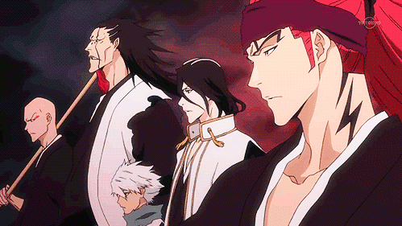

# Bleach Intelligence Database

<p align="center">
  
</p>

An interactive, high-performance character relationship intelligence database for the *Bleach* universe — built to visually explore bloodlines, rivalries, factions, and alliances across the series, from the Kurosaki lineage and Gotei 13 to the Espada, Wandenreich Sternritter, Squad Zero, Original Gotei 13 founders, and light novel continuations.

Inspired by Obsidian's graph view and styled around the *Thousand-Year Blood War* aesthetic.

---

## 🌟 Overview

Rather than piecing together wiki pages to trace alliances and rivalries, this application renders the *Bleach* universe as a hardware-accelerated **interactive force-directed graph** with **189 characters** and **379 canonical relationships**.

Click any character node to open their classified dossier, trigger custom animated Zanpakutō/Bankai sidebar themes, explore direct ties and story-arc timelines, or trace the shortest path between any two characters in the network.

---

## ✨ Features

### Interactive Network & Navigation
- **Hardware-Accelerated Force-Directed Graph**: HTML5 Canvas + [D3.js](https://d3js.org/) & [Force-Graph](https://github.com/vasturiano/force-graph) physics engine for smooth pan, zoom, node dragging, and tiered Level-of-Detail (LOD) transitions across 189 characters.
- **5-Tier Lore-Accurate Node Hierarchy**:
  - **Tier 1 (Sovereigns & Supreme Powers)**: Ichigo, Aizen, Yhwach, Yamamoto, Soul King, Ichibē.
  - **Tier 2 (Captains, Squad Zero, Top Espada & Elite Quincy)**: Gotei 13 Captains, Royal Guard, Original Gotei 13, Schutzstaffel, Top Espada, Urahara, Ginjo, Jugram, Uryū.
  - **Tier 3 (Lieutenants, Core Sternritter, Mid Espada & Visoreds)**: Seated lieutenants, Sternritter, core Arrancar, and key allies.
  - **Tier 4 (Secondary Officers & Privaron Espada)**: Supporting Shinigami, Fullbringers, and Privaron Espada.
  - **Tier 5 (Fracción & Supporting Cast)**: Compact satellite nodes orbiting their masters.
- **7 Interactive Faction Cluster Views**: Filter the graph to isolate a faction with tailored spatial layouts and atmospheric canvas backdrops (`assets/backgrounds/`):
  - **All Galaxy** — Full 189-character network centered on Ichigo Kurosaki.
  - **Gotei 13** — Captains, lieutenants, and seated officers centered on Yamamoto.
  - **Wandenreich** — Yhwach, Schutzstaffel, and Sternritter over Silbern.
  - **Hueco Mundo** — Aizen, Gin, Tōsen, the Espada, and orbiting Fracción over Las Noches.
  - **Royal Realm** — Soul King (Reiō) and Squad Zero over the Soul King Palace.
  - **Karakura Town** — Human defenders, Urahara Shop, and Fullbringers.
  - **Original Gotei** — The legendary founding captains of the first Gotei 13.
- **Tactical Radar Minimap**: Real-time bird's-eye radar in the bottom-left corner with click-and-drag viewport navigation.
- **Shortest-Path BFS Tracer**: Select any character, click **Trace Path**, and choose a target to highlight degrees of separation with animated directional particles.
- **Command Palette (`Ctrl + K` / `Cmd + K`) & URL Hash Deep Linking**: Instantly jump to any character, faction, or bloodline — or share direct links like `index.html#aizen`.
- **Responsive Desktop & Mobile UI**: Pure CSS loader, floating hover HUD card, race legend filtering, and mobile bottom-drawer layout.

### 34 Custom Animated Character Dossier Panels
Opening a featured character's dossier triggers bespoke CSS/Canvas/WebGL/SVG Zanpakutō and Bankai animations (`panels/css/` & `panels/js/`), custom high-resolution backdrops (`assets/panels/`), and animated character badges (`assets/gifs/`):

- **Sovereigns, War Potentials & Key Figures (8)**: Ichigo Kurosaki *(with Hollow Mask entrance GIF)*, Sōsuke Aizen *(shattering Kyōka Suigetsu glass)*, Yhwach *(The Almighty)*, Genryūsai Shigekuni Yamamoto *(Zanka no Tachi flames)*, Kisuke Urahara *(Benihime crimson seams)*, Kenpachi Zaraki *(Nozarashi meteor cleave + Zaraki GIF)*, Rukia Kuchiki *(Hakka no Togame frost)*, Soul King *(Reiō)*.
- **Squad Zero / Royal Guard (5)**: Ichibē Hyōsube, Ōetsu Nimaiya, Senjumaru Shutara, Tenjirō Kirinji, Kirio Hikifune.
- **Gotei 13 Captains (10)**: Soi Fon, Gin Ichimaru, Retsu Unohana, Byakuya Kuchiki, Sajin Komamura, Shunsui Kyōraku, Kaname Tōsen, Tōshirō Hitsugaya *(Daiguren Hyōrinmaru ice dragon)*, Mayuri Kurotsuchi, Jūshirō Ukitake.
- **Gotei 13 Lieutenants (11)**: Chōjirō Sasakibe, Marechiyo Ōmaeda, Izuru Kira, Isane Kotetsu, Momo Hinamori, Renji Abarai, Nanao Ise, Shuhei Hisagi, Rangiku Matsumoto, Yachiru Kusajishi, Nemu Kurotsuchi.
- **Character Name GIFs & Dossier Tabs**: Animated badge GIFs for Ichigo and Ulquiorra, plus 3-tab dossiers (**Overview**, **Relations**, **Timeline**) with navigation history.
- **Gotei 13 Theme Preview Sandbox**: Open [`demos/gotei13-demo.html`](demos/gotei13-demo.html) to preview and tune all 19 Gotei 13 captain and lieutenant sidebar themes side by side.

### High-Performance Sprite Pipeline
- **Unified WebP Sprite Sheet (`assets/sprites/characters.webp`)**: `scripts/build_sprites.py` auto-discovers all **185 character portraits** in `assets/portraits/`, applies face-centered Lanczos cropping into 192×192px tiles, and compiles them into a single `2304×3072` WebP sheet (~1.23 MB) with mtime/size cache invalidation and an embedded Base64 fallback for local `file://` viewing.

---

## ⌨️ Shortcuts & Controls

| Key / Action | Function |
| :--- | :--- |
| `Ctrl + K` / `Cmd + K` | Open Command Palette / Quick Search |
| `Escape` | Close active dossier, search overlay, or path tracer |
| `Click Node` | Open character dossier, activate custom theme, and focus neighborhood |
| `Click Active Node` | Deselect and restore full graph visibility |
| `Click / Drag Minimap` | Pan viewport via bottom-left tactical radar |
| `Faction Bar Buttons` | Switch faction cluster layout and canvas backdrop |
| `Race Legend Items` | Filter visible nodes by race |
| `Double-Click Background` | Reset camera fit and clear selections |
| `Scroll Wheel` | Semantic zoom in / out |
| `Drag Node / Background` | Reposition character node / pan canvas |

---

## 🛠️ Tech Stack

- **Graph & Physics**: [D3.js v7](https://d3js.org/) + [Force-Graph](https://github.com/vasturiano/force-graph) on HTML5 Canvas.
- **Character Panel Effects**: Vanilla JS, HTML5 2D Canvas, WebGL shaders, SVG filters, and CSS animations (zero build-tool runtime dependencies).
- **Asset & Build Pipeline**: Python 3 + [Pillow](https://python-pillow.org/) (`scripts/build_sprites.py`, `scripts/obsidian_network.py`).
- **Data Layer**: Canonical JSON datasets (`data/characters.json`, `data/relationships.json`).
- **Typography**: Google Fonts (*Cinzel*, *Inter*).

---

## 🚀 Getting Started

### Prerequisites
- **Python 3.8+** with **Pillow** (only needed when rebuilding `index.html` or adding portraits)
  ```bash
  pip install pillow
  ```
- Any modern web browser (Chrome, Edge, Firefox, Safari, Brave)

### Build & Run

```bash
# Clone the repository
git clone https://github.com/prashantshreh-pixel/Bleach-Tree.git
cd Bleach-Tree

# Compile the sprite sheet and generate index.html
python scripts/obsidian_network.py
```

This scans `assets/portraits/`, updates `assets/sprites/characters.webp` + `characters-map.json` when portraits change, and generates root **`index.html`**.

Open `index.html` directly in your browser (or serve locally):
```bash
# Windows
start index.html

# macOS
open index.html

# Linux
xdg-open index.html
```

To preview the standalone Gotei 13 animated sidebar themes:
```bash
start demos/gotei13-demo.html
```

---

## 📁 Project Structure

```text
Bleach Tree/
├── assets/
│   ├── backgrounds/              # Faction cluster backdrops (Hueco Mundo, Wandenreich, Royal Realm, Original 13)
│   ├── gifs/                     # Animated character badges, Zaraki effect GIF, and README preview GIF
│   ├── panels/                   # High-resolution dossier banners & Bankai theme backgrounds
│   ├── portraits/                # 185 deduplicated source character portraits
│   ├── sprites/                  # Compiled WebP sprite sheet, coordinate map, and build cache
│   └── bankai_favicon.svg        # Site favicon
├── data/
│   ├── characters.json           # Canonical character registry (189 characters)
│   └── relationships.json        # Canonical relationship database (379 edges)
├── demos/
│   └── gotei13-demo.html         # Interactive showcase for the 19 Gotei 13 animated sidebar themes
├── panels/
│   ├── css/                      # 34 character-specific animated dossier stylesheets (*-panel.css)
│   └── js/                       # 34 character-specific animated dossier engines (*-panel.js)
├── scripts/
│   ├── build_sprites.py          # Automated face-crop & WebP sprite sheet compiler
│   └── obsidian_network.py       # Main compiler generating root index.html
├── index.html                    # Compiled interactive web application (GitHub Pages entry point)
├── README.md                     # Project documentation
└── .gitignore
```

---

## 📜 Disclaimer

This is an unofficial, non-commercial fan project created for data visualization and educational purposes. *Bleach* and all associated characters, names, and lore are the property of **Tite Kubo**, **Shueisha**, and **Studio Pierrot**.
